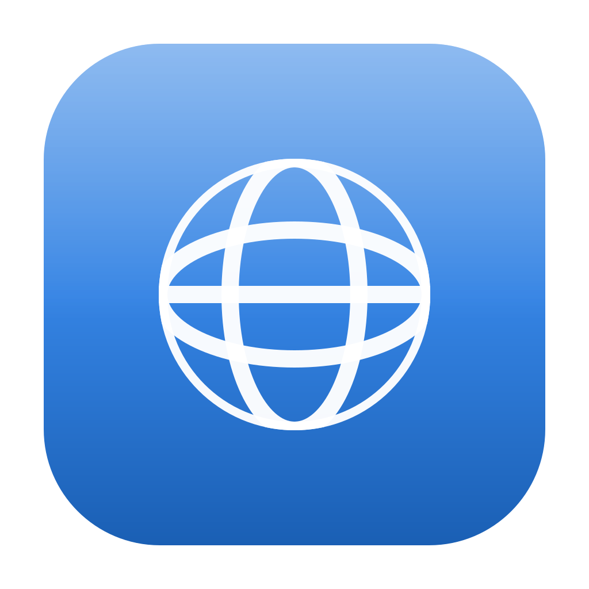

# Project Indigo

Project Indigo is a small native GTK browser shell.

## Install

*This adds the nebuff repo with the indigo package in it.

```sh
curl -sSL https://install.nebuff.xyz/indigo | bash
```

## Building

Install the system libraries and build tools (the project does not install packages):

```sh
sudo dnf install gtk4-devel meson ninja-build pkgconf-pkg-config gcc webkitgtk6.0-devel
```

## Build and run

From the project root:

```sh
meson setup build
ninja -C build
./build/indigo
```

## Desktop look

Indigo follows the desktop it runs on: GNOME sessions get a header bar with
the navigation controls and address bar, and fall back from a leftover
KDE/Breeze theme to Adwaita. KDE sessions keep the toolbar above the tab
strip and their system theme. Set `INDIGO_LOOK=gnome` or `INDIGO_LOOK=kde`
to force one look on any desktop.
